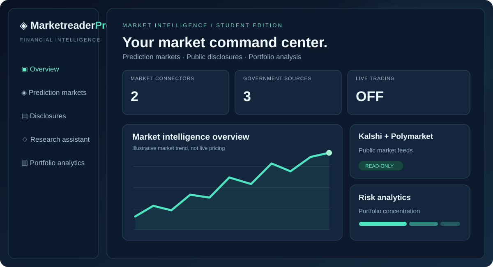
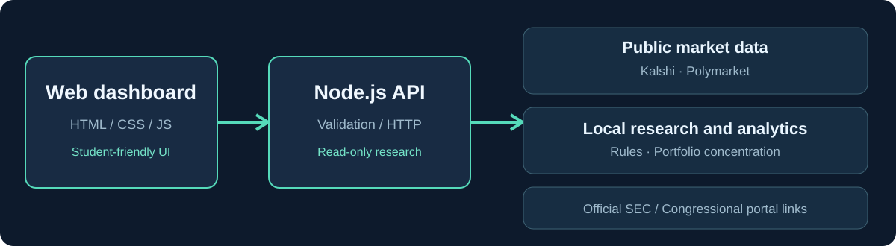

# MarketreaderPro



> **Visual note:** illustration, not a screenshot of deployed software or real market returns.



**Read-only financial market research platform for students and beginners.** Now with optional PostgreSQL market history storage and transactionally applied SQL migrations. Explore public prediction markets, official financial disclosure portals, concentration analytics and transparent educational research.

**Release status:** deployment-hardened *research prototype*. Not a regulated bank, brokerage, AI investment adviser, or production trading system. No bank login, deposits, personalized trading advice or real-money order placement.

## Run locally

Requires Node.js 22+. PostgreSQL is optional for the public dashboard and required for persistence.

```bash
npm install
npm start
# http://localhost:3000
npm run verify
```

Docker:

```bash
docker build -t marketreaderpro .
docker run --rm -p 3000:3000 marketreaderpro
```

See **[Database installation and migrations](docs/DATABASE.md)** for persistence and Docker Compose instructions.

Read **[Deployment and security checklist](docs/DEPLOYMENT.md)** before exposing a service publicly.

## Included

- Responsive web dashboard with original SVG illustration, historical database explorer, student simulation accounts, and SEC filing lookup.
- Public Kalshi/Polymarket best-effort connectors, individual upstream failure handling, request timeouts, response-field allowlists and a 30-second cache.
- Official SEC / US House / US Senate disclosure source links (not scraping/analysis).
- Explainable, rule-based *educational* research responses; no connected language model.
- Portfolio concentration calculator with validation.
- Same-origin CSP, browser security headers, request IDs, body size limits, basic per-process rate limiting and graceful shutdown.
- Liveness/readiness API endpoints, integration/unit tests, GitHub CI and Docker health check.

## Endpoints

| Method | Route | Purpose |
|---|---|---|
| GET | `/api/health` | Process liveness |
| GET | `/api/ready` | Local readiness |
| GET | `/api/markets` | Public Kalshi/Polymarket feed summaries |
| GET | `/api/disclosures` | Official disclosure portal directory |
| POST | `/api/research` | Keyword-based educational market research |
| POST | `/api/risk` | Hypothetical portfolio concentration |

Sample request:

```bash
curl -X POST http://localhost:3000/api/risk -H 'content-type: application/json' -d '{"positions":[{"symbol":"ETF-A","value":600},{"symbol":"ETF-B","value":400}]}'
```

## Additional working modules (v0.5)

- Credential-gated Plaid backend Link-token issuance, token exchange, encrypted server-side token storage, read-only account fetching, and connection revocation. Plaid Link frontend interaction and provider approval still required; no banking credentials collected by the app.
- PostgreSQL-backed user registration, password verification, revocable bearer sessions and multi-user simulated trading balances and positions.
- Optional hosted model-generated educational research through server-configured `AI_API_KEY` and `AI_MODEL`, with transparent rule-based fallback.
- Read-only SEC filing metadata lookup by CIK. Configure `SEC_USER_AGENT` with an organization and contact email.
- See [integrations and limitations](docs/INTEGRATIONS.md). None of these are real broker trades or full SEC transaction extraction.

## Still needed for actual financial-product production readiness

Secure authentication and identity, authorized bank/broker data integrations, actual government filing ingestion, retrieval-grounded AI, comprehensive observability, regulated trading partnerships, audited financial controls, data handling/privacy program, extensive security testing and real-world deployment verification. See [docs/DEPLOYMENT.md](docs/DEPLOYMENT.md).

**Risk disclaimer:** Public congressional disclosures are typically delayed and do not establish unlawful insider trading. Market data can be unavailable or outdated. Do not use nonpublic information. No deposits or orders are supported.

## Database attribution
Database schemas and queries are original code. Integrates the permissively licensed [PostgreSQL](https://github.com/postgres/postgres) engine and the MIT-licensed [node-postgres driver](https://github.com/brianc/node-postgres); does not copy other repositories' user data.
