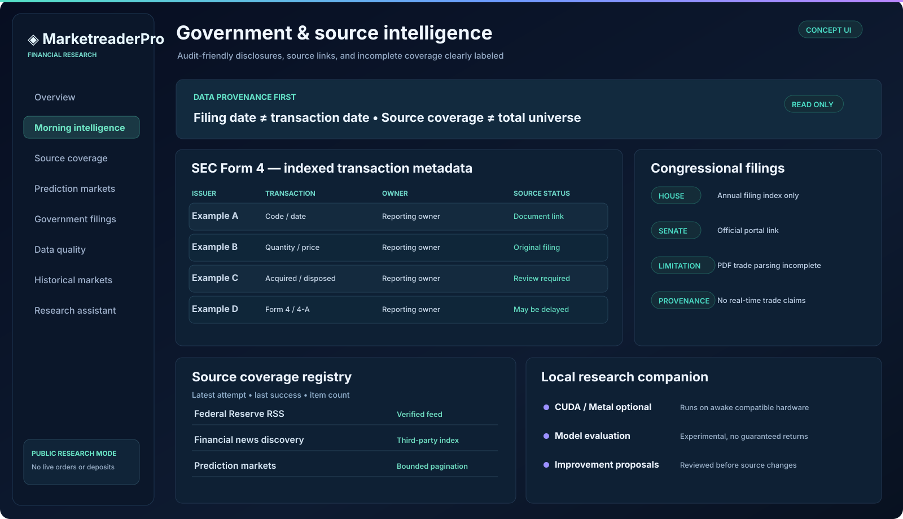

<div align="center">

# ◈ MarketreaderPro

### Open-source financial research infrastructure

**Market intelligence · Source provenance · Government filings · Prediction markets · Local GPU research**

[](https://github.com/samadalam481470sa-cmd/MarketreaderPro/actions/workflows/ci.yml)


[Download ZIP](https://github.com/samadalam481470sa-cmd/MarketreaderPro/archive/refs/heads/main.zip) · [Quick start](docs/QUICKSTART.md) · [Architecture](docs/DEPLOYMENT.md) · [Intelligence docs](docs/INTELLIGENCE.md)

</div>


> **Design illustration, not a screenshot of a deployed instance or live market quotes.** The UI has no real-money execution. Real source data appears only after providers are reachable and ingestion is configured.

## At a glance

MarketreaderPro is a modular **read-only market intelligence and educational research application**. It brings together source-linked financial news, public prediction-market snapshots, historical observations, SEC ownership filings, and transparent data-quality indicators. Its separate opt-in Python companion can perform local numerical research using CUDA or Apple Metal where available.

**Release scope:** research beta with automated tests and container build checks, **not** a regulated bank, brokerage, investment adviser, or audited production financial platform.

<table>
<tr><td>📈 <b>Market discovery</b><br/>Bounded paginated Kalshi and Polymarket public API scans.</td><td>📰 <b>News intelligence</b><br/>Federal Reserve, BLS, and four GDELT topic searches.</td></tr>
<tr><td>🏛️ <b>Official filings</b><br/>SEC Form 4 metadata and transaction XML for configured CIKs; opt-in House filing index.</td><td>🛡️ <b>Data quality</b><br/>Timestamp/freshness labels, quote validation, source links, and coverage gaps.</td></tr>
<tr><td>🧠 <b>Research tools</b><br/>Educational rules; optional paid model-generated morning commentary.</td><td>⚡ <b>Local GPU companion</b><br/>Opt-in Python snapshots, experimental supervised training, reviewable change proposals.</td></tr>
</table>

## Interface gallery

**Morning intelligence — source-linked research and feed health**


**Government filings, research coverage, and local agent**



*Both previews are stylized mockups with illustrative entries. They deliberately omit fabricated current stock prices or claims of deployment.*

## Run on your machine

Download the [ZIP](https://github.com/samadalam481470sa-cmd/MarketreaderPro/archive/refs/heads/main.zip) or clone the repository. You need **Docker Desktop with Docker Compose**. The scripts provision a local PostgreSQL instance, migrate schema, perform an initial intelligence collection, and start the morning worker.

**Windows PowerShell**

```powershell
git clone https://github.com/samadalam481470sa-cmd/MarketreaderPro.git
cd MarketreaderPro
$env:POSTGRES_PASSWORD="REPLACE_WITH_A_LONG_UNIQUE_SECRET"
.\scripts\start-windows.ps1
```

**macOS / Linux**

```bash
git clone https://github.com/samadalam481470sa-cmd/MarketreaderPro.git
cd MarketreaderPro
export POSTGRES_PASSWORD="REPLACE_WITH_A_LONG_UNIQUE_SECRET"
sh scripts/start-unix.sh
```

Open **http://localhost:3000**. Data sources may be temporarily unavailable; the app records partial collection rather than silently replacing it with invented data.

For a lighter evaluation without persistence:

```bash
npm install
npm run verify
npm start
```

The public page starts without PostgreSQL, but saved briefings and account-backed features require the database. This is a downloadable source project, **not a signed Windows or macOS installer**. See [full setup](docs/QUICKSTART.md).

## Intelligence pipeline

```text
 Official RSS ──┐
 GDELT discovery├──> Validate & deduplicate ──> PostgreSQL
 Prediction APIs├──> Provenance, freshness    │
 SEC filings ───┘                            ├──> Briefing API ──> Dashboard
                                           └──> 7 AM Central worker
 Optional configured AI ──> Labeled commentary on source titles
 Optional local GPU agent ──> Separate SQLite research journal
```

Daily worker: [scheduler documentation](docs/INTELLIGENCE.md). For always-on briefs when your own computer is off, deploy the worker on a persistent remote server. A sleeping local computer cannot run GPU training.

## Trust and limitations

| Capability | Current implementation |
|---|---|
| Public macro news | Official Federal Reserve/BLS RSS endpoints; availability may vary |
| Broader financial headlines | GDELT topic discovery, not every news publisher |
| Prediction markets | Limited paginated Kalshi/Polymarket scan, not every contract |
| SEC trades | Selected configured CIKs; Form 4 transactions may lag or be amended |
| U.S. House | Operator-supplied annual filing index; **PDF trades not fully parsed** |
| U.S. Senate | Official disclosure portal links; **no automatic Senate importer** |
| Live brokerage/bank transfers | **Unavailable** |
| AI morning summary | Optional; requires operator-provided API configuration |
| GPU learning | Opt-in local process when computer is awake |
| Accuracy | Data checks and source visibility, **not a factual guarantee** |

Experimental account, paper trading, and bank-aggregation routes are **disabled in public mode**. Never enter banking credentials in this research prototype. The app does not submit live orders or move real funds.

## Project map

| Directory | Responsibility |
|---|---|
| `apps/api` | Read-only public API, provider connectors, validation |
| `apps/web` | Dashboard and research interface |
| `db/migrations` | PostgreSQL schema, indexes and migrations |
| `scripts` | Ingestion, scheduler, local startup and smoke checks |
| `agent` | Python local research and optional GPU training |
| `tests`, `tests_py` | Node and Python unit/integration tests |
| `docs` | Engineering, legal boundaries, deployment instructions |

## Verification

```bash
npm run verify
python3 -m unittest discover -s tests_py -v
npm run db:migrate
npm run smoke
```

GitHub Actions runs Node/Python tests, PostgreSQL schema checks, builds a Docker image and boots the container for smoke tests. **Passing CI does not establish banking-grade production readiness or successful connection to every external provider.**

## API examples

```bash
curl http://localhost:3000/api/health
curl http://localhost:3000/api/capabilities
curl http://localhost:3000/api/coverage
curl http://localhost:3000/api/intelligence
curl http://localhost:3000/api/government/sec-transactions?limit=20
```

See [financial data accuracy](docs/INTELLIGENCE.md), [official disclosures](docs/GOVERNMENT_DISCLOSURES.md), [local GPU agent](docs/LOCAL_GPU_AGENT.md), [database](docs/DATABASE.md), and [deployment release gate](docs/PRODUCTION_RELEASE.md).

---

<sub>Educational and engineering research software. Not investment advice. Source publication dates and ingestion timestamps are different. Government financial disclosures can be delayed and are not evidence of unlawful activity. Licensed-data rights, regional availability, security reviews, and independent verification remain the operator's responsibility.</sub>
