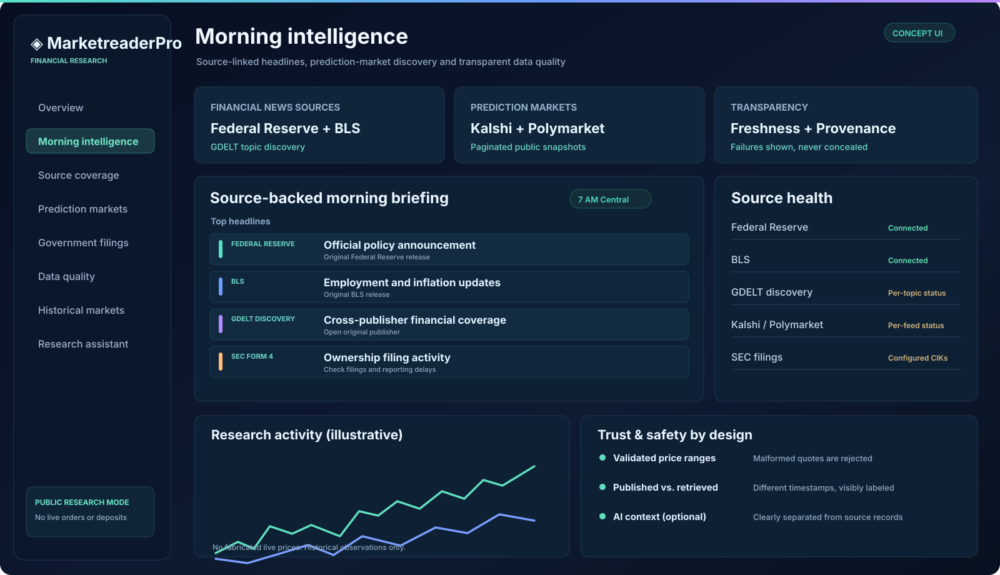

<div align="center">

# ◈ MarketreaderPro

### Source-backed financial intelligence workspace

**Financial news · Government disclosures · Prediction market discovery · Historical analytics · Local GPU research**

[](https://github.com/samadalam481470sa-cmd/MarketreaderPro/actions/workflows/ci.yml)
[](https://github.com/samadalam481470sa-cmd/MarketreaderPro/actions/workflows/package.yml)


**[Download app package](https://github.com/samadalam481470sa-cmd/MarketreaderPro/actions/workflows/package.yml)** · **[Download source ZIP](https://github.com/samadalam481470sa-cmd/MarketreaderPro/archive/refs/heads/main.zip)** · **[Install guide](docs/QUICKSTART.md)**

</div>

## Application dashboard

The application now contains an interactive dark financial workspace with source-status cards, morning news, government filings, and prediction-market feeds. Panels connect to the real backend and explicitly display unavailable sources and missing history.



*The illustration shows the design direction; the actual running dashboard uses the matching dark theme and fetches its contents from API endpoints. The illustration itself is not a live screenshot.*

## Install and launch

**Windows (Docker Desktop required)**

```powershell
# In the extracted MarketreaderPro folder
$env:POSTGRES_PASSWORD="YOUR_UNIQUE_LONG_PASSWORD"
.\scripts\start-windows.ps1
```

**macOS / Linux (Docker Compose required)**

```bash
export POSTGRES_PASSWORD="YOUR_UNIQUE_LONG_PASSWORD"
sh scripts/start-unix.sh
```

Open **http://localhost:3000**. The startup scripts migrate PostgreSQL, attempt initial source ingestion and start the scheduled 7 AM Central intelligence worker while the Docker host remains available.

A lighter read-only run is possible with `npm install && npm start`, but historical/briefing features require a configured database. This is a downloadable application source package, **not a signed native desktop installer**.

## Capabilities

| Component | Current function |
|---|---|
| Dashboard | Real API-populated navigation, intelligence panels and status cards |
| Market discovery | Kalshi and Polymarket public feed integration, limited by provider access |
| Financial news | Federal Reserve, BLS, and GDELT topic-based discovery |
| Government filings | SEC Form 4 XML transactions for configured CIKs; opt-in House filing index; Senate portal links |
| Historical market indicators | SMA, EMA and RSI via MIT-licensed [technicalindicators](https://github.com/anandanand84/technicalindicators) |
| Data quality | Timestamps, invalid-value rejection, stale data labels, original source links |
| Scheduled morning briefs | Dedicated server worker, targeting 7 AM America/Chicago |
| AI | Optional source-grounded narrative when an external AI API is configured |
| Local GPU research | Opt-in Python agent using CUDA/Metal when the computer is awake |
| Persistence | PostgreSQL plus separate local agent SQLite history |

### Open-source contribution

MarketreaderPro integrates the MIT-licensed **technicalindicators** package for SMA, EMA and RSI calculations. Its original authors retain attribution. See [third-party software and licensing](docs/THIRD_PARTY.md). The tool is used for descriptive statistics on historical public-market probability observations, not live order signals.

## Releases & packages

On every push to `main`, GitHub Actions is configured to upload a **MarketreaderPro-application** ZIP artifact and publish the Docker image to **GitHub Container Registry**.

[**Download release artifact from successful workflow**](https://github.com/samadalam481470sa-cmd/MarketreaderPro/actions/workflows/package.yml)

Container command, after the workflow publishes and the package visibility permits access:

```bash
docker pull ghcr.io/samadalam481470sa-cmd/marketreaderpro:latest
```

The ZIP includes the server, frontend, GPU companion, migrations, scripts, Docker Compose and documentation. A local database and source access are still required for continuous intelligence collection.

## Source architecture

```text
 Federal Reserve / BLS ─┐
 GDELT financial news ───┤
 Public market APIs ─────├──> Validation + provenance ──> PostgreSQL ──> Research API ──> Interactive dashboard
 SEC Form 4 / House ─────┘                                        │
                                                         Morning scheduler
 Local GPU research (optional) ──> SQLite + PyTorch
```

Read the [database guide](docs/DATABASE.md), [intelligence sources](docs/INTELLIGENCE.md), [government disclosure constraints](docs/GOVERNMENT_DISCLOSURES.md), and [GPU companion](docs/LOCAL_GPU_AGENT.md).

## Code-size audit

Run `npm run code:audit` to view source lines by component, excluding vendored third-party packages, generated assets and documentation. The CI workflow attaches the same audit as a JSON artifact. This makes progress toward the requested 50,000-line milestone measurable without artificial padding. [Methodology](docs/CODEBASE_SIZE.md).

## Verify locally

```bash
npm install
npm run verify
npm run package:check
python3 -m unittest discover -s tests_py -v
```

CI also validates PostgreSQL migrations, a Docker build, and HTTP smoke tests. A passing build does not guarantee an external data provider is reachable in your location or license every global exchange.

## Financial safety and product scope

This is a **read-only research application**. Real-money trading, banking transfers, every global exchange/news channel, complete House PDF trading extraction and automated Senate disclosure ingestion are **not supported**. Experimental accounts and integrations are disabled by default. Source articles, filings and prices may be inaccurate or delayed; verify originals before making financial decisions.

The app is ready to download and run locally with its prerequisites, but a publicly deployed or independently audited financial platform is a different release milestone.

[Deployment checklist](docs/PRODUCTION_RELEASE.md) · [Setup](docs/QUICKSTART.md) · [GitHub Actions](https://github.com/samadalam481470sa-cmd/MarketreaderPro/actions)